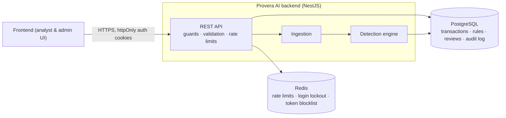
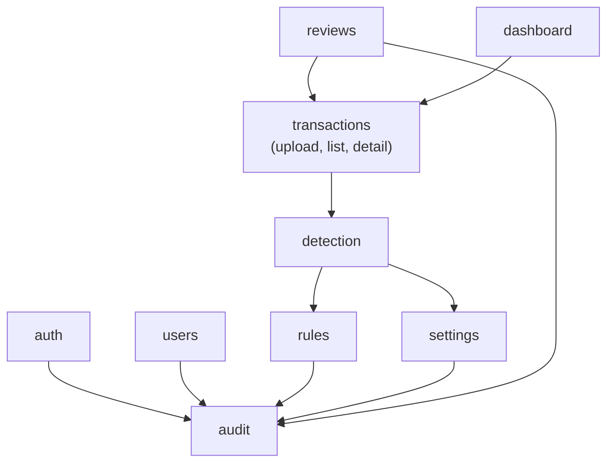
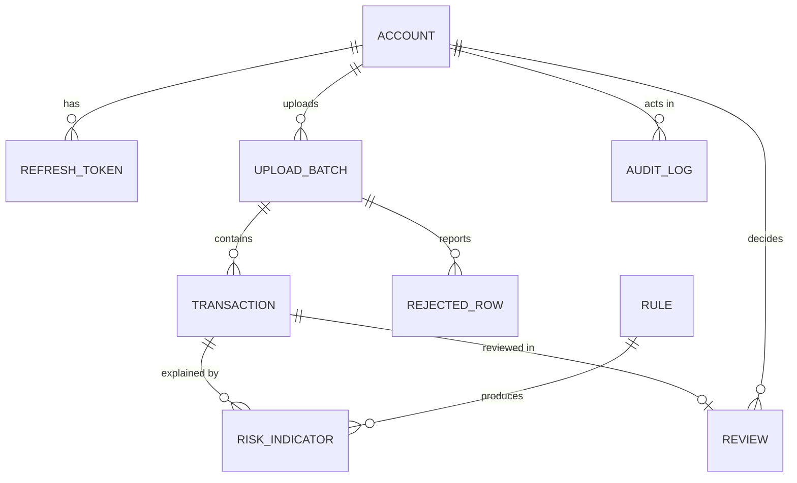
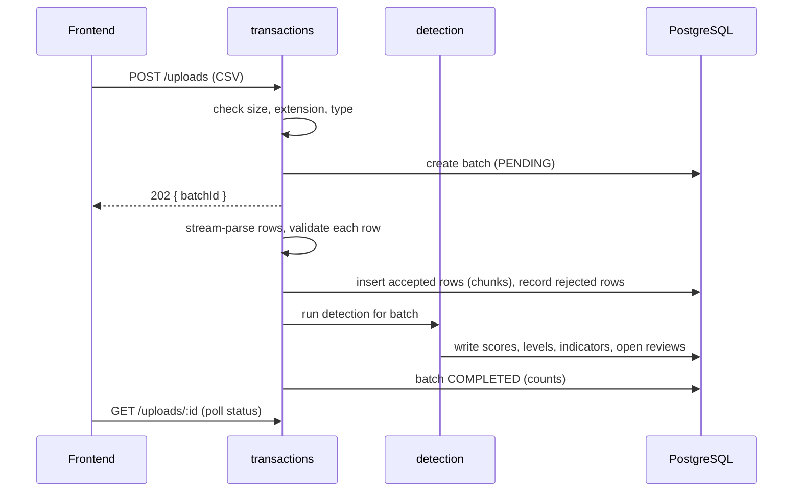
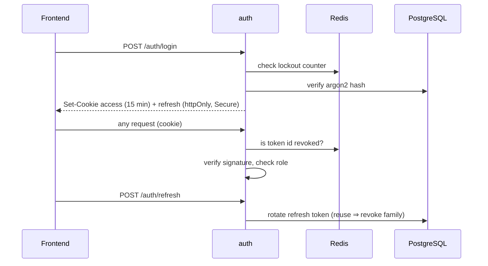

# Provera AI — Backend Architecture

This document explains how the Provera AI backend is built: its components, how a transaction moves through the system, the data model, how detection and risk scoring work, and where each security requirement is enforced.

---

## 1. What the system does

```
Upload transactions → validate → detect suspicious patterns → assign risk (Low / Medium / High)
→ explain why → flag for review → analyst investigates and records a decision
```

Design principles:

1. **Human in the loop.** The engine produces a signal, and an analyst makes the determination. Nothing is blocked, frozen or decided automatically.
2. **Explainable.** Every risk level comes with the rules that triggered it and a plain-language reason. A score is never shown without context.
3. **Configurable without deploys.** Detection rules and risk bands are data that admins manage from the frontend, not hard-coded values.
4. **Rule-based, in-house.** Detection runs inside this service.
5. **MVP-sized.** File upload instead of streaming, one service, one database. No queues, no microservices.

## 2. System context



| Component | Role |
|---|---|
| NestJS API | Single entry point. Authentication, role checks, validation and rate limiting run before any handler |
| PostgreSQL | System of record: accounts, uploads, transactions, rules, risk indicators, reviews, settings, audit log |
| Redis | Short-lived security state: rate-limit counters (shared across instances), failed-login counters, revoked access-token ids |

## 3. Code architecture

### 3.1 Layers

Every feature module has the same shape, and requests flow one way:

```
controller → service → sub-services → model-actions → database
```

| Layer | Responsibility | Never |
|---|---|---|
| Controller | Routing, DTO binding, Swagger docs, role decorators | Business logic |
| Main service | Orchestrates sub-services in order | Own logic or DB access |
| Sub-service (`services/`) | One job each (parse CSV, evaluate rules, issue tokens…) | Use a TypeORM `Repository` directly |
| Model action (`model-actions/`) | The only layer that queries the database | Business rules |
| Model (`models/`) | TypeORM entity (one table) | Behaviour |
| DTO (`dtos/`) | Validates and documents request bodies | — |

Modules talk to each other **only through exported services**, never through another module's models or model actions.

### 3.2 Module map



| Module | Responsibility | Status |
|---|---|---|
| `auth` | Login, refresh, logout, current user. Global `AuthGuard` (deny by default) and `RolesGuard` | In progress |
| `users` | Admin creates, deactivates and changes the role of accounts. No self-signup | Planned |
| `audit` | Append-only, tamper-evident audit log. Exports `AuditService` to every other module | Planned |
| `settings` | Risk bands and the minimum risk level that gets flagged | Planned |
| `transactions` | CSV upload, row validation, upload status, transaction listing, filters and detail | Planned |
| `rules` | Admin-defined detection rules: schema, validation, versioning, activation, preview | Planned |
| `detection` | Evaluates rules against transactions, scores them, writes risk indicators | Planned |
| `reviews` | Analyst claims a flagged transaction and records a decision with notes | Planned |
| `dashboard` | Aggregated metrics and trends | Planned |

### 3.3 Cross-cutting infrastructure (already in place)

| Concern | Where |
|---|---|
| Config + env validation at boot | `src/common/config/` |
| Global auth guard, `@Public()`, `@CurrentUser()` | `modules/auth/guards/`, `common/decorators/` |
| Validation (`whitelist`, `forbidNonWhitelisted`, `transform`) | `main.ts` |
| One error shape, no stack traces to clients | `common/filters/http-exception.filter.ts` |
| Rate limiting with Redis-backed counters | `app.module.ts`, `common/redis/redis-throttler-storage.ts` |
| Security headers (helmet), CORS allowlist, cookie parsing | `main.ts` |
| Migrations run on startup, `synchronize` off | `database/data-source.ts` |

## 4. Data model



| Table | Key columns | Notes |
|---|---|---|
| `accounts` | email, password hash, role (`ADMIN` / `ANALYST`), isActive, tokenVersion | One account per person (AR-21). `tokenVersion` is bumped to revoke all sessions |
| `refresh_tokens` | accountId, token hash, familyId, expiresAt, revokedAt | Only hashes are stored. Reusing a revoked token revokes the whole family |
| `upload_batches` | uploadedBy, fileName, status, total / accepted / rejected counts, timestamps | Status: `PENDING → PROCESSING → COMPLETED / FAILED` |
| `rejected_rows` | batchId, rowNumber, reasons | Shows why a row was not accepted |
| `transactions` | externalId (from file), amount, currency, occurredAt, type, channel, customerId, location, paymentMethod, extra attributes, riskScore, riskLevel, flagged | Risk fields are written once by the engine and cannot be updated through the API (R-02) |
| `rules` | ruleKey, version, name, type, conditions, params, weight, reason, status, createdBy, activatedBy | Versioned. Editing creates a new version, and old versions are kept |
| `risk_indicators` | transactionId, ruleId (exact version), weight, reason, details | The explanation for a transaction stays accurate after rules change |
| `reviews` | transactionId, assignedTo, status, decision, notes, decidedAt | Decision: `CLEARED` or `ESCALATED`. Notes are required (TR-14) |
| `settings` | key, value | Risk bands, flagged level |
| `audit_logs` | actor, action, entity, metadata, ip, prevHash, hash, createdAt | Insert-only, with each row's hash chained to the previous one (AR-26) |

## 5. Transaction ingestion



- **Processing** runs in the background inside the API process, and the upload record holds the status. A queue isn't needed at MVP volumes.
- **File checks:** a size limit, a row cap, `.csv` only, and a header row that must match the expected columns.
- **Row validation (TR-18):** required fields present, amount positive and within bounds, a valid timestamp that isn't in the future, values from the allowed lists for type, channel and payment method, and text length limits. Text cells starting with `=`, `+`, `-` or `@` are rejected, so the data can't be used for spreadsheet formula injection when exported later.
- **Fail visibly:** a bad row is rejected with its reasons and never silently fixed. A batch that cannot be read at all ends as `FAILED` with an error message.
- **Duplicates:** `externalId` is unique, so a re-uploaded transaction is rejected instead of being scored twice.

## 6. Detection engine

### 6.1 Rules are data

Rules are created and tuned by admins from the frontend. The frontend sends **structured JSON, never code**, and the backend checks every rule against an allowlist before saving it.

There are two kinds of rule:

**Condition rules** look at one transaction. They are trees of `field / operator / value` conditions combined with `all` or `any`:

```jsonc
{
  "name": "Example: large card payment at night",
  "type": "CONDITION",
  "conditions": {
    "all": [
      { "field": "amount", "op": "gte", "value": "<threshold>" }, // placeholder
      { "field": "paymentMethod", "op": "in", "value": ["CARD"] },
      { "field": "hourOfDay", "op": "between", "value": ["<from>", "<to>"] } // placeholders
    ]
  },
  "weight": "<points>", // placeholder
  "reason": "Large card payment during unusual hours"
}
```

**History-based rules** compare a transaction with the customer's earlier activity. Each type's logic is implemented in code, and admins create instances and set their parameters, optionally narrowed by a condition filter:

| Type | Signal | Parameters |
|---|---|---|
| `VELOCITY` | Many transactions from one customer in a short window | count, window |
| `AMOUNT_DEVIATION` | Amount far above this customer's usual amount | multiplier, minimum history |
| `NEW_LOCATION` | Location never seen before for this customer | — |
| `NEW_PAYMENT_METHOD` | Payment method never used before by this customer | — |

`GET /rules/schema` returns the allowed fields, operators, value types and rule types, so the frontend builds its rule editor from it instead of hard-coding them.

Actual thresholds and weights live only in the database, are visible only to admins, and are deliberately left out of this document (TR-11).

### 6.2 Rule safety

| Control | Why |
|---|---|
| Allowlisted fields and operators, type-checked values, depth and size limits | A rule cannot reference arbitrary data or overload the engine (TR-18) |
| Custom interpreter. No `eval`, `new Function` or regex operators | Rule input can never execute code |
| Only `ADMIN` can create, edit, activate or retire rules | AR-18 |
| Every change is audited with before and after values | AR-25, TR-10 |
| Versioned and immutable. Indicators reference the exact version | Explanations stay true, and ratings cannot be silently rewritten (R-02) |
| Draft → active needs a **different** admin *(open decision)* | Four-eyes change control (TR-10) |
| `POST /rules/preview` dry-runs a draft against recent transactions without writing anything | Tune before activating, which limits false positives (TR-12) |
| Analysts see rule names and reasons, never thresholds | TR-11 |

Rule changes apply to uploads made after the change. An admin can re-run detection for a past batch, and that action is audited.

### 6.3 Evaluation and scoring

For each batch:

1. Load the active rules and the settings once.
2. Load prior history for the customers in the batch.
3. Walk the transactions in time order. Earlier rows in the same batch count as history.
4. Evaluate every rule. Each rule that fires produces a **risk indicator** (rule, weight, reason, observed facts such as "amount is 18× this customer's median").
5. **Score** = the sum of the fired rules' weights, capped at 100.
6. **Risk level** from admin-configurable bands:

   | Level | Default band |
   |---|---|
   | Low | 0 – 29 (includes "no indicators") |
   | Medium | 30 – 69 |
   | High | 70 – 100 |

7. **Flagged** = risk level at or above the configured flag level. Each flagged transaction gets an `OPEN` review.

Adding up weights means one rule alone does not have to make a transaction High. Several independent signals together do, which makes the engine harder to game by staying just under a single threshold (TR-11, R-05).

## 7. Review workflow

```
OPEN → IN_REVIEW (claimed by an analyst) → CLOSED (CLEARED or ESCALATED, notes required)
```

- Any analyst can view any transaction (single-organisation MVP). Only the analyst who claimed a review can record its decision (object-level rule, AR-17).
- The decision is the platform's determination. The risk level is only the signal that prompted the review.
- Every claim and decision is audited.

## 8. API surface

All routes require authentication unless marked public. Full request and response schemas are in Swagger at `/api/docs`.

| Area | Endpoint | Role |
|---|---|---|
| Health | `GET /health` | public |
| Auth | `POST /auth/login` (public), `POST /auth/refresh`, `POST /auth/logout`, `GET /auth/me` | any |
| Upload | `POST /uploads`, `GET /uploads`, `GET /uploads/:id` | any |
| Transactions | `GET /transactions?risk=&flagged=&from=&to=&customerId=&type=&page=` | any |
| | `GET /transactions/:id` (fields, risk level, indicators with reasons, review) | any |
| Reviews | `POST /transactions/:id/review/claim`, `PATCH /transactions/:id/review` | analyst |
| Dashboard | `GET /dashboard/summary`, `GET /dashboard/trends` | any |
| Rules | `GET /rules/schema`, `GET /rules`, `POST /rules`, `PATCH /rules/:id`, `POST /rules/:id/activate`, `POST /rules/:id/retire`, `POST /rules/preview` | admin |
| Settings | `GET /settings`, `PATCH /settings` | admin |
| Users | `GET /users`, `POST /users`, `PATCH /users/:id` | admin |
| Audit | `GET /audit-logs` | admin |
| Detection | `POST /uploads/:id/rescore` | admin |

Dashboard metrics: total analysed, flagged count and percentage, count per risk level, most common indicators, and activity over time.

## 9. Authentication and access control



| Requirement | Implementation |
|---|---|
| AR-01 every endpoint authenticated | Global `AuthGuard`, deny by default, `@Public()` only on login and health |
| AR-02 password hashing | argon2 |
| AR-03 brute force | 5 login attempts per minute per IP (throttler) plus lockout after repeated failures per account (Redis) |
| AR-04 no account enumeration | Same error for an unknown email, a wrong password or a locked account |
| AR-05 password policy | Minimum 12 characters (DTO validation) |
| AR-06/07 signing | HS256 with a strong secret from the environment, validated at boot |
| AR-09/10 short-lived tokens | 15-minute access token. Rotating refresh token, stored hashed |
| AR-11 revocation | Token-id blocklist in Redis plus `tokenVersion` on the account |
| AR-12 minimal payload | `sub`, `role`, `jti` only |
| AR-13/14 transport and storage | HTTPS only, tokens only in `httpOnly; Secure` cookies, never in URLs or logs |
| AR-15/16/18 roles | `ADMIN`, `ANALYST`. Global `RolesGuard` with `@Roles()` on admin routes |
| AR-17 object-level access | Review decisions are scoped to the claiming analyst in the model-action query |
| AR-19 denied access logged | `RolesGuard` writes a security event to the audit log |
| AR-20 role tests | Automated tests assert that every admin route rejects an analyst |
| AR-21 no shared accounts | Accounts are created by admins for named individuals. No signup endpoint |

**CSRF.** Auth uses cookies, so the frontend and API should share a parent domain (e.g. `app.` and `api.`) with `SameSite=Lax` cookies. If they are deployed on unrelated domains, a CSRF token check is required on every state-changing request *(open decision)*.

## 10. Audit logging

Logged events: logins (success, failure, lockout), logouts, token refresh reuse, permission denials, account changes, rule and setting changes, rescoring, uploads, and review claims and decisions.

- Insert-only: a database trigger rejects `UPDATE` and `DELETE` on `audit_logs` (AR-26).
- Tamper-evident: each row stores a hash of its content plus the previous row's hash, so edits or deletions break the chain (TR-10).
- Never logged: passwords, tokens, cookies, full request bodies.

## 11. Security controls summary

| Threat | Control |
|---|---|
| TR-01/09 leaked secrets | Secrets only in env vars, validated at boot. `.env` is gitignored. Secret scanning in CI. Separate prod and dev secrets |
| TR-02/03 token theft and exposure | Short expiry, rotation, revocation, minimal payload |
| TR-04/05 privilege escalation, IDOR | Global guards, role tests, scoped queries, `ParseUUIDPipe` on ids |
| TR-06 brute force, DoS | Throttler with Redis store, per-account lockout, upload size and row caps |
| TR-07 error leakage | Global exception filter returns a generic shape. No stack traces to clients |
| TR-08 SQL injection | TypeORM parameterised queries only. No string-built SQL |
| TR-10/13 untraceable changes | Admin-only rules, two-admin activation, tamper-evident audit log |
| TR-11 threshold exposure | Thresholds only on admin endpoints. Analysts see reasons. Weights are summed |
| TR-14 rubber-stamping | Required decision notes. Indicators shown instead of a bare score |
| TR-18 malicious input | Strict DTO and row validation, rule-schema validation, fail visibly |
| Encryption (GRC) | TLS for clients and for the DB connection. Managed Postgres encrypted at rest |
| Backups (TR-17) | Managed daily backups. One restore rehearsed before go-live |

Production hardening: Swagger UI disabled, `trust proxy` set behind the host's load balancer, CORS restricted to the frontend's origin.

## 12. Infrastructure and delivery

| Piece | Choice |
|---|---|
| Runtime | Node.js 24, single NestJS service |
| Database | Managed PostgreSQL (TLS, encryption at rest, daily backups) |
| Cache / security state | Managed Redis |
| CI | GitHub Actions: `npm ci`, `npm audit`, lint, tests, build |
| CD | GitHub Actions after CI passes on `main` *(deploy target to be chosen)* |
| Telemetry | NestJS Observe is supported but **off** unless keys are set. It is an external service and needs security sign-off |


